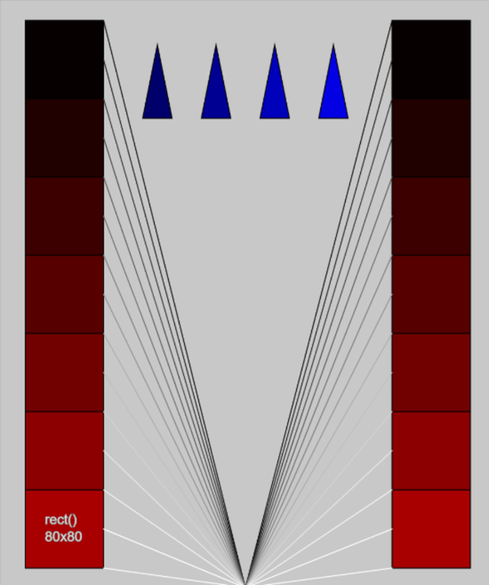

# Lab 7 - For Loops

You will be writing your code in `sketch.js` within the main folder - not the `example/` folder.

Re-create the sketch below.

- Each rectangle is 80x80.

- Place as much code as you want inside a for loop. See if you can draw **all** rectangles **and** lines within one loop.

- The triangles will need a different loop.

Remember to:

- Update the header

- Include comments
